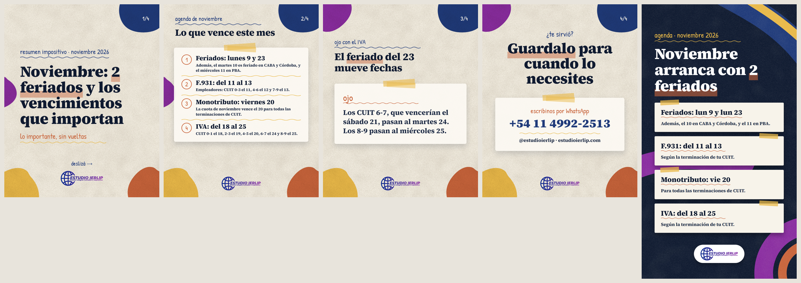
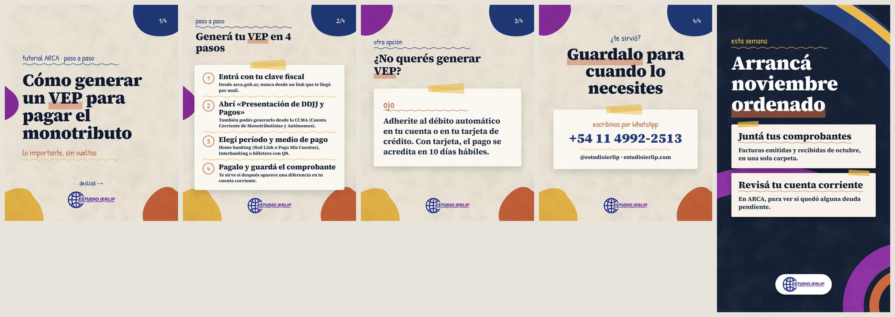
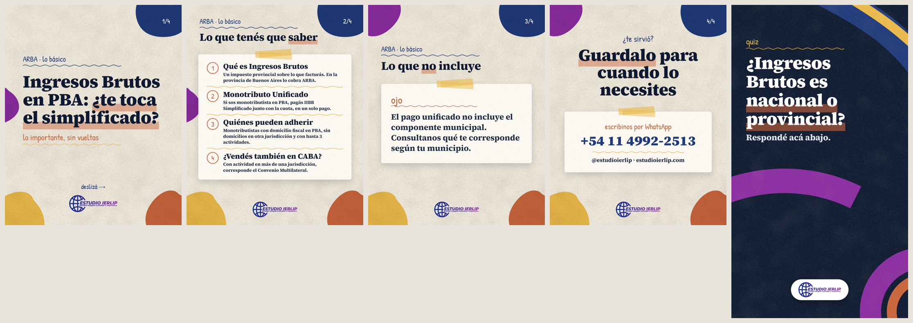
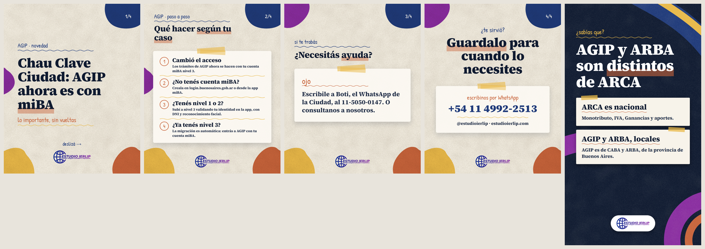
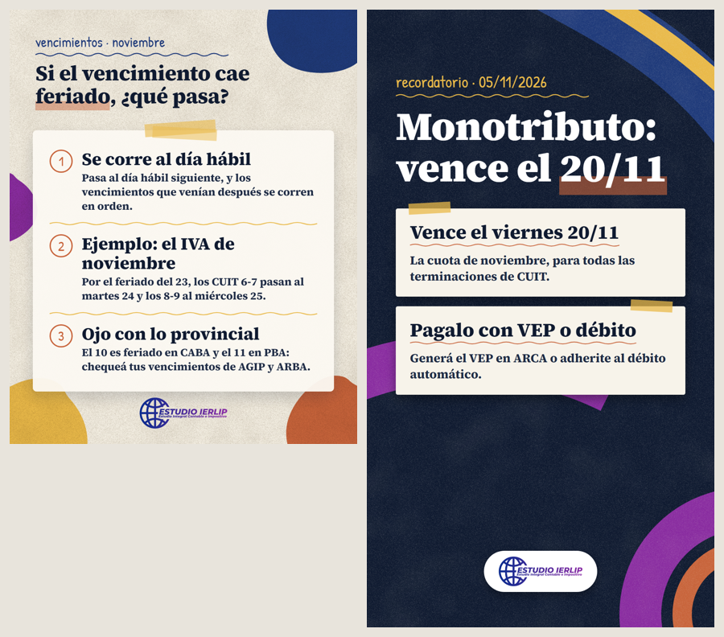
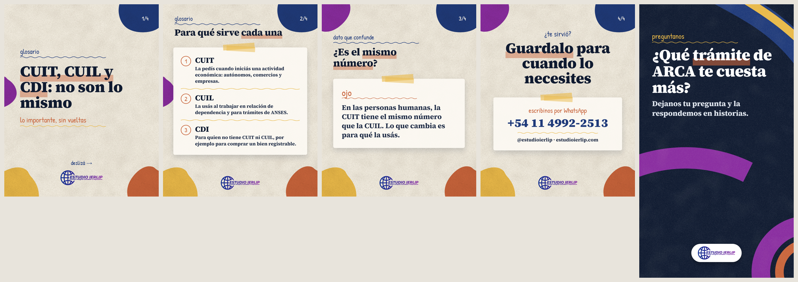
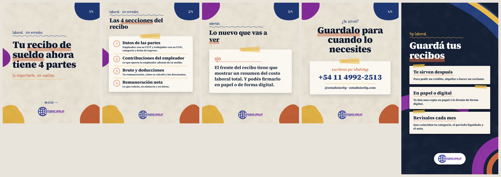

# Semana 1 al 7/11/2026: revisión

Nada está cargado ni programado. Las fuentes de cada dato están en `output/<fecha>/meta.json`.


## 2026-11-01 (dom) · Resumen: Noviembre: 2 feriados y los vencimientos que importan



- Placa: 2026-11-01T11:00:00-03:00 · Historia: 2026-11-01T09:00:00-03:00
- Sticker nativo: ninguno

**Caption**

```
📅 Noviembre viene con 2 feriados nacionales y varios vencimientos. Te los dejamos ordenados:

• Feriados: lunes 9 y lunes 23 (el 10 rige en CABA y Córdoba, y el 11 en PBA).
• F.931 (empleadores): del 11 al 13, según CUIT.
• Monotributo: viernes 20, todas las terminaciones.
• IVA: del 18 al 25, según CUIT. Por el feriado del 23, los CUIT 6-7 pasan al 24 y los 8-9 al 25.

Guardalo para cuando lo necesites 📌
Escribinos por WhatsApp: +54 11 4992-2513
@estudioierlip · estudioierlip.com

#EstudioIERLIP #Vencimientos #ARCA #Monotributo #IVA #Impuestos #Contador #Pymes
```

**VERIFICAR ANTES DE PUBLICAR**

- [ ] Confirmar el alcance de los feriados del 10/11 (CABA y Córdoba) y 11/11 (PBA) en el Boletín Oficial / normas locales.
- [ ] Volver a mirar la agenda de ARCA el 31/10 por si hay prórrogas.

**Fuentes**

- https://seti.afip.gob.ar/av/seleccionVencimientos.do (agenda oficial 01/11 a 30/11/2026, actualizada al 26/10/2026)
- Decreto 1103/2026 (feriados 9, 10 y 11/11)

## 2026-11-02 (lun) · Tutorial ARCA: Cómo generar un VEP para pagar el monotributo



- Placa: 2026-11-02T12:00:00-03:00 · Historia: 2026-11-02T09:00:00-03:00
- Sticker nativo: Link a WhatsApp: https://wa.me/541149922513 (texto: «Escribinos»)

**Caption**

```
💳 ¿Tenés que pagar el monotributo y no sabés cómo generar el VEP? Son 4 pasos:

1. Entrá con tu clave fiscal en arca.gob.ar.
2. Abrí «Presentación de DDJJ y Pagos» (o la CCMA).
3. Elegí el período y el medio de pago: home banking, Interbanking o billetera con QR.
4. Pagalo y guardá el comprobante.

¿Preferís no pensar en eso? Adherite al débito automático.

Guardalo para cuando lo necesites 📌
Escribinos por WhatsApp: +54 11 4992-2513
@estudioierlip · estudioierlip.com

#EstudioIERLIP #Monotributo #ARCA #VEP #Tutorial #Emprendedores #Impuestos
```

**VERIFICAR ANTES DE PUBLICAR**

- [ ] Entrar a ARCA y confirmar que el servicio sigue llamándose «Presentación de DDJJ y Pagos» el día de publicación.

**Fuentes**

- https://www.arca.gob.ar/comoPagarImpuestos/como-pagar-impuestos/monotributo/desde-07-2004.asp

## 2026-11-03 (mar) · ARBA: Ingresos Brutos en PBA: ¿te toca el simplificado?



- Placa: 2026-11-03T12:00:00-03:00 · Historia: 2026-11-03T09:00:00-03:00
- Sticker nativo: Cuestionario: Nacional / Provincial (correcta: Provincial)

**Caption**

```
🏠 ¿Sos monotributista en la provincia de Buenos Aires? Puede que pagues Ingresos Brutos sin darte cuenta.

Con el Monotributo Unificado, el IIBB Simplificado de ARBA se paga junto con tu cuota, en un solo pago. Pueden adherir quienes tienen domicilio fiscal en PBA (y ninguno fuera) y hasta 3 actividades.

¿Vendés también en CABA? Ahí corresponde el Convenio Multilateral.

Guardalo para cuando lo necesites 📌
Escribinos por WhatsApp: +54 11 4992-2513
@estudioierlip · estudioierlip.com

#EstudioIERLIP #ARBA #IngresosBrutos #Monotributo #ConvenioMultilateral #ProvinciaDeBuenosAires #Impuestos
```

**VERIFICAR ANTES DE PUBLICAR**

- [ ] Definición de IIBB («sobre lo que facturás») y quién debe inscribirse: confirmar con el Código Fiscal de PBA en arba.gov.ar.
- [ ] Que quien tiene actividad en CABA quede fuera del Simplificado de PBA: solo visto en un fragmento de ARBA.

**Fuentes**

- https://www.afip.gob.ar/monotributo/ayuda/monotributo-unificado.asp
- https://web.arba.gov.ar/preguntas-frecuentes/quienes-pueden-acceder-ingresos-brutos-simplificado-ibs
- https://www.arba.gov.ar/GuiaTramites/TramiteSeleccionado.asp?tramite=674&categ=34
- https://www.ca.gov.ar/2016-03-21-17-33-41?showall=1

## 2026-11-04 (mie) · AGIP: Trámites de AGIP: ahora con miBA nivel 3



- Placa: 2026-11-04T12:00:00-03:00 · Historia: 2026-11-04T09:00:00-03:00
- Sticker nativo: Encuesta: Lo sabía / No lo sabía

**Caption**

```
🔑 Si hacés trámites en AGIP, ojo: la Clave Ciudad ya no se usa. Ahora entrás con tu cuenta miBA nivel 3.

• ¿No tenés cuenta? Creala en login.buenosaires.gob.ar o en la app miBA.
• ¿Tenés nivel 1 o 2? Subí a nivel 3 validando tu identidad con DNI y reconocimiento facial.
• ¿Ya tenés nivel 3? La migración es automática.

Guardalo para cuando lo necesites 📌
Escribinos por WhatsApp: +54 11 4992-2513
@estudioierlip · estudioierlip.com

#EstudioIERLIP #AGIP #CABA #miBA #IngresosBrutos #Tramites #Impuestos
```

**VERIFICAR ANTES DE PUBLICAR**

- [ ] La noticia oficial es del 28/10/2025: confirmar en agip.gob.ar que sigue vigente y que no hubo cambios en los niveles.
- [ ] Número de Boti 11-5050-0147: confirmar en buenosaires.gob.ar.

**Fuentes**

- https://buenosaires.gob.ar/gcaba_historico/noticias/ahora-los-tramites-de-agip-se-realizaran-con-cuenta-miba

## 2026-11-05 (jue) · Vencimientos: Si el vencimiento cae feriado, ¿qué pasa?



- Placa: 2026-11-05T12:00:00-03:00 · Historia: 2026-11-05T09:00:00-03:00
- Sticker nativo: Cuenta regresiva: «Vence el monotributo», 20/11 a las 09:00. Alternativa: subir output/2026-11-05/historia-animada.mp4 como segunda historia.

**Caption**

```
🗓️ ¿Qué pasa si un vencimiento cae sábado, domingo o feriado? Se corre al día hábil siguiente, y los que venían después se corren en orden.

Ejemplo de este mes: por el feriado del lunes 23, el IVA de los CUIT 6-7 pasa al martes 24 y el de los 8-9 al miércoles 25.

Y ojo con los feriados provinciales: el 10 en CABA y el 11 en PBA.

Guardalo para cuando lo necesites 📌
Escribinos por WhatsApp: +54 11 4992-2513
@estudioierlip · estudioierlip.com

#EstudioIERLIP #Vencimientos #Feriados #IVA #ARCA #ARBA #AGIP
```

**VERIFICAR ANTES DE PUBLICAR**

- [ ] Leer la RG 4172 en boletinoficial.gob.ar.
- [ ] Si ARBA corre vencimientos por el feriado del 11/11 (pista no oficial: RN ARBA 21/2026, al 12/11) y si AGIP corre los del 10/11.

**Fuentes**

- https://seti.afip.gob.ar/av/seleccionVencimientos.do (agenda oficial de noviembre 2026)
- RG (AFIP) 4172: traslado correlativo de vencimientos (texto leído en copia de un consejo profesional)

## 2026-11-06 (vie) · Glosario: CUIT, CUIL y CDI: no son lo mismo



- Placa: 2026-11-06T12:00:00-03:00 · Historia: 2026-11-06T09:00:00-03:00
- Sticker nativo: Caja de preguntas: «¿Qué trámite de ARCA te cuesta más?»

**Caption**

```
🪪 CUIT, CUIL y CDI parecen lo mismo, pero no lo son:

• CUIT: para quien inicia una actividad económica.
• CUIL: para trabajar en relación de dependencia y hacer trámites en ANSES.
• CDI: para quien no tiene CUIT ni CUIL y necesita operar, por ejemplo para comprar un bien registrable.

Dato: en personas humanas, la CUIT tiene el mismo número que la CUIL.

Guardalo para cuando lo necesites 📌
Escribinos por WhatsApp: +54 11 4992-2513
@estudioierlip · estudioierlip.com

#EstudioIERLIP #CUIT #CUIL #CDI #ARCA #Glosario #Impuestos
```

**VERIFICAR ANTES DE PUBLICAR**

- Nada pendiente.

**Fuentes**

- https://www.argentina.gob.ar/servicio/obtener-la-clave-de-identificacion-cdi
- https://www.argentina.gob.ar/servicio/obtener-cuil

## 2026-11-07 (sab) · Laboral: Tu recibo de sueldo ahora tiene 4 partes



- Placa: 2026-11-07T11:00:00-03:00 · Historia: 2026-11-07T09:00:00-03:00
- Sticker nativo: ninguno

**Caption**

```
🧾 El recibo de sueldo cambió: ahora se arma en 4 secciones.

1. Datos del empleador y del trabajador.
2. Contribuciones del empleador.
3. Remuneración bruta y deducciones.
4. Remuneración neta.

Además, el frente tiene que mostrar un resumen del costo laboral total. ¿Tenés empleados? Te ayudamos a adaptarte.

Guardalo para cuando lo necesites 📌
Escribinos por WhatsApp: +54 11 4992-2513
@estudioierlip · estudioierlip.com

#EstudioIERLIP #ReciboDeSueldo #Laboral #RRHH #Empleadores #Pymes #Sueldos
```

**VERIFICAR ANTES DE PUBLICAR**

- [ ] Releer el Decreto 407/2026: que el detalle de cada sección (categoría y fecha de ingreso en la 1, «cómo se calculó» en la 3) coincida con el texto.
- [ ] Que la obligación del resumen del costo laboral en el frente ya esté vigente (fecha de aplicación del decreto).

**Fuentes**

- https://www.argentina.gob.ar/normativa/nacional/norma-423680/texto (Ley 27.802, arts. 139 y 140 LCT)
- https://www.argentina.gob.ar/normativa/nacional/norma-426270/texto (Decreto 407/2026)
