# Semana 8 al 20/11/2026: revisión

Nada está cargado todavía. Las fuentes de cada dato están en `output/<fecha>/meta.json`.


## 2026-11-08 (dom) · Resumen: Lo importante de la semana, sin vueltas

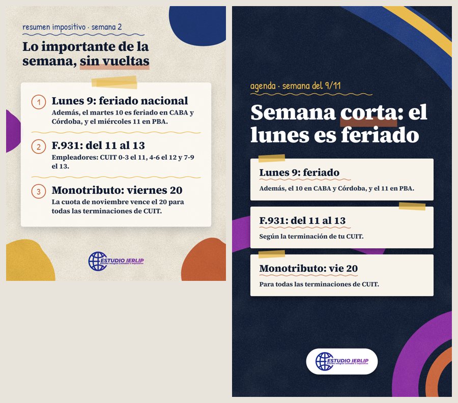

- Placa: 2026-11-08T11:00:00-03:00 · Historia: 2026-11-08T09:00:00-03:00
- Sticker nativo: ninguno

**Caption**

```
🗓️ Semana corta y con vencimientos. Lo importante, sin vueltas:

• Lunes 9: feriado nacional (el 10 es feriado en CABA y Córdoba, y el 11 en PBA).
• F.931 (empleadores): del 11 al 13, según CUIT.
• Monotributo: viernes 20, todas las terminaciones.

Guardalo para cuando lo necesites 📌
Escribinos por WhatsApp: +54 11 4992-2513
@estudioierlip · estudioierlip.com

#EstudioIERLIP #Vencimientos #ARCA #Monotributo #F931 #Feriados #Impuestos
```

**VERIFICAR ANTES DE PUBLICAR**

- [ ] Confirmar el alcance de los feriados del 10/11 (CABA y Córdoba) y 11/11 (PBA) en el Boletín Oficial / normas locales.

**Fuentes**

- https://seti.afip.gob.ar/av/seleccionVencimientos.do (agenda oficial de noviembre 2026)
- Decreto 1103/2026

## 2026-11-09 (lun) · Tutorial ARCA: Cómo descargar tu constancia de inscripción

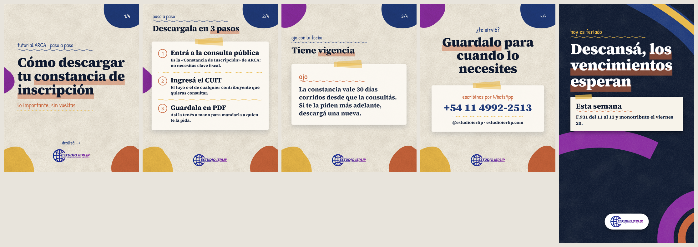

- Placa: 2026-11-09T12:00:00-03:00 · Historia: 2026-11-09T09:00:00-03:00
- Sticker nativo: Link a WhatsApp: https://wa.me/541149922513 (texto: «Escribinos»)

**Caption**

```
📄 ¿Te pidieron la constancia de inscripción? La descargás en un minuto y sin clave fiscal:

1. Entrá a la consulta pública «Constancia de Inscripción» de ARCA.
2. Ingresá el CUIT.
3. Guardala en PDF.

Ojo: vale 30 días corridos desde que la consultás.

Guardalo para cuando lo necesites 📌
Escribinos por WhatsApp: +54 11 4992-2513
@estudioierlip · estudioierlip.com

#EstudioIERLIP #ARCA #ConstanciaDeInscripcion #Monotributo #Tutorial #Emprendedores #Impuestos
```

**VERIFICAR ANTES DE PUBLICAR**

- [ ] Que la consulta pública siga activa en esa dirección el día de publicación.

**Fuentes**

- https://seti.arca.gob.ar/padron-puc-constancia-internet/ConsultaConstanciaAction.do
- https://serviciosweb.afip.gob.ar/genericos/guiaspasopaso/VerGuia.aspx?id=174

## 2026-11-10 (mar) · ARBA: Cómo obtener tu CIT de ARBA

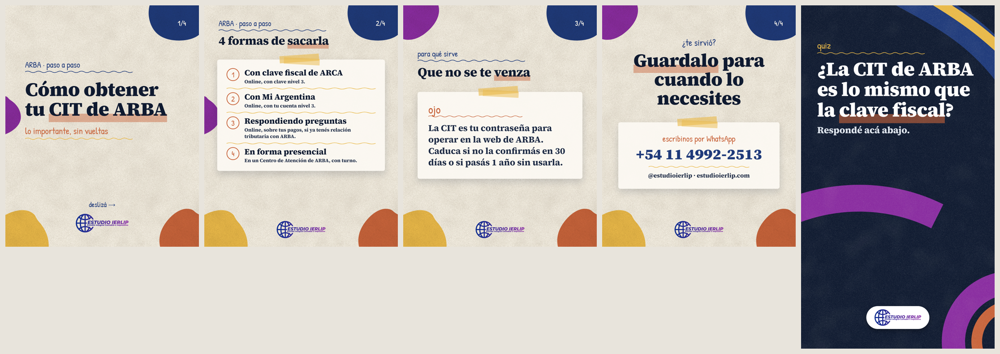

- Placa: 2026-11-10T12:00:00-03:00 · Historia: 2026-11-10T09:00:00-03:00
- Sticker nativo: Cuestionario: Sí / No (correcta: No)

**Caption**

```
🔐 ¿Necesitás operar en la web de ARBA? Vas a necesitar tu CIT (Clave de Identificación Tributaria). La podés sacar de 4 formas:

• Online, con clave fiscal de ARCA nivel 3.
• Online, con Mi Argentina nivel 3.
• Online, respondiendo preguntas sobre tus pagos (si ya tenés relación con ARBA).
• En forma presencial, con turno.

Ojo: caduca si no la confirmás en 30 días o si pasás 1 año sin usarla.

Guardalo para cuando lo necesites 📌
Escribinos por WhatsApp: +54 11 4992-2513
@estudioierlip · estudioierlip.com

#EstudioIERLIP #ARBA #CIT #IngresosBrutos #ProvinciaDeBuenosAires #Tutorial #Impuestos
```

**VERIFICAR ANTES DE PUBLICAR**

- [ ] ARBA dice que la clave actual sirve «hasta la transición definitiva»: confirmar que no haya cambios anunciados para noviembre.
- [ ] Confirmar el alcance de los feriados del 10/11 (CABA y Córdoba) y 11/11 (PBA) en el Boletín Oficial / normas locales.

**Fuentes**

- https://identity.arba.gov.ar/identity/public/ConoceMas
- https://www.arba.gov.ar/GuiaTramites/TramiteSeleccionado.asp?tramite=214&categ=33
- https://www.arba.gov.ar/GuiaTramites/TramiteSeleccionado.asp?tramite=634&categ=33

## 2026-11-11 (mie) · AGIP: Ingresos Brutos en CABA si sos monotributista


- Placa: 2026-11-11T12:00:00-03:00 · Historia: 2026-11-11T09:00:00-03:00
- Sticker nativo: Encuesta: ¿Trabajás hoy? Sí / No

**Caption**

```
🏙️ Si sos monotributista en CABA, desde 2026 el Ingresos Brutos se paga junto con tu cuota del monotributo, en ARCA:

• Un solo pago y un solo vencimiento, el 20 de cada mes.
• Altas, bajas y recategorizaciones, todo en ARCA.
• Si estabas en los dos regímenes, pasaste de oficio.

Quedan afuera, entre otros, quienes no tienen domicilio fiscal en CABA o son responsables inscriptos en IVA.

Guardalo para cuando lo necesites 📌
Escribinos por WhatsApp: +54 11 4992-2513
@estudioierlip · estudioierlip.com

#EstudioIERLIP #AGIP #CABA #IngresosBrutos #MonotributoUnificado #Monotributo #Impuestos
```

**VERIFICAR ANTES DE PUBLICAR**

- [ ] Confirmar el alcance de los feriados del 10/11 (CABA y Córdoba) y 11/11 (PBA) en el Boletín Oficial / normas locales.

**Fuentes**

- https://imagenes.agip.gob.ar/campanas/Monotributo-Unificado

## 2026-11-12 (jue) · Vencimientos: Débito automático del monotributo

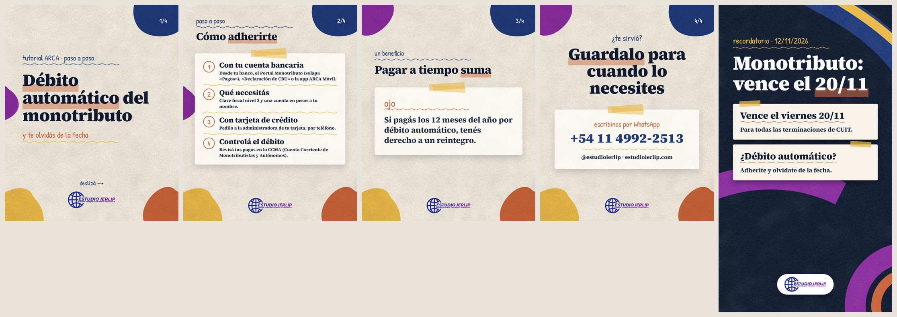

- Placa: 2026-11-12T12:00:00-03:00 · Historia: 2026-11-12T09:00:00-03:00
- Sticker nativo: Cuenta regresiva: «Vence el monotributo», 20/11 a las 09:00

**Caption**

```
💳 ¿Querés olvidarte de la fecha del monotributo? Adherite al débito automático:

• Con tu cuenta bancaria: desde tu banco, el Portal Monotributo (solapa «Pagos»), el servicio «Declaración de CBU» o la app ARCA Móvil.
• Con tarjeta de crédito: pedilo a la administradora de tu tarjeta.

Después controlá que se debite en la CCMA. Y si pagás los 12 meses por débito, tenés derecho a un reintegro.

Guardalo para cuando lo necesites 📌
Escribinos por WhatsApp: +54 11 4992-2513
@estudioierlip · estudioierlip.com

#EstudioIERLIP #Monotributo #ARCA #DebitoAutomatico #Tutorial #Emprendedores #Impuestos
```

**VERIFICAR ANTES DE PUBLICAR**

- [ ] Condiciones vigentes del reintegro por pagar los 12 meses por débito automático.
- [ ] Desde qué período rige la adhesión (no se menciona en la pieza).

**Fuentes**

- https://www.afip.gob.ar/comoPagarImpuestos/como-pagar-impuestos/monotributo/desde-07-2004.asp
- https://serviciosweb.afip.gob.ar/genericos/guiaspasopaso/VerGuia.aspx?id=286
- https://www.afip.gob.ar/monotributo/ayuda/pagos.asp

## 2026-11-13 (vie) · Glosario: Alícuota, percepción y retención, explicadas fácil

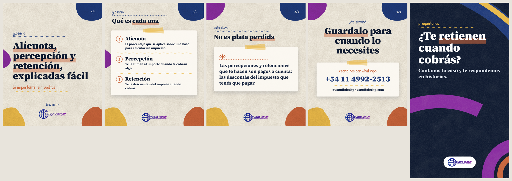

- Placa: 2026-11-13T12:00:00-03:00 · Historia: 2026-11-13T09:00:00-03:00
- Sticker nativo: Caja de preguntas: «¿Te retienen cuando cobrás?»

**Caption**

```
📚 Tres palabras que aparecen en todas tus facturas y liquidaciones:

• Alícuota: el porcentaje que se aplica para calcular un impuesto.
• Percepción: te la suman al importe cuando te cobran algo.
• Retención: te la descuentan cuando cobrás.

Lo importante: percepciones y retenciones son pagos a cuenta. Las descontás del impuesto que tenés que pagar.

Guardalo para cuando lo necesites 📌
Escribinos por WhatsApp: +54 11 4992-2513
@estudioierlip · estudioierlip.com

#EstudioIERLIP #Glosario #IngresosBrutos #Retenciones #Percepciones #ARBA #AGIP
```

**VERIFICAR ANTES DE PUBLICAR**

- Nada pendiente.

**Fuentes**

- https://www.arba.gov.ar/Informacion/Agentes/Recaudacion/diferencias.asp
- https://www.agip.gob.ar/agentes/agentes-de-recaudacion/ib-agentes-recaudacion/informacion-de-interes-para-los-contribuyentes-sujetos-a-percepcionretencion

## 2026-11-14 (sab) · Laboral: F.931: qué es y quién lo presenta

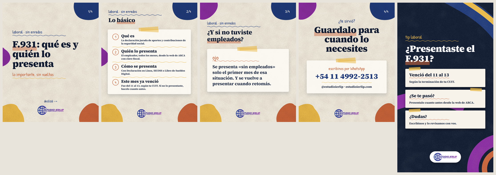

- Placa: 2026-11-14T11:00:00-03:00 · Historia: 2026-11-14T09:00:00-03:00
- Sticker nativo: ninguno

**Caption**

```
👥 ¿Tenés empleados? Entonces el F.931 es tuyo:

• Es la declaración jurada de aportes y contribuciones de la seguridad social.
• La presenta el empleador todos los meses, desde la web de ARCA.
• Se hace con Declaración en Línea, SICOSS o Libro de Sueldos Digital.

Este mes venció del 11 al 13. Si se te pasó, presentalo cuanto antes.

Guardalo para cuando lo necesites 📌
Escribinos por WhatsApp: +54 11 4992-2513
@estudioierlip · estudioierlip.com

#EstudioIERLIP #F931 #Laboral #Empleadores #ARCA #RRHH #Pymes
```

**VERIFICAR ANTES DE PUBLICAR**

- Nada pendiente.

**Fuentes**

- https://servicioscf.afip.gob.ar/publico/abc/ABCpaso2.aspx?id_nivel1=558&id_nivel2=942
- https://www.afip.gob.ar/LibrodeSueldosDigital/documentos/G26-DJ-sin-nomina.pdf
- https://seti.afip.gob.ar/av/seleccionVencimientos.do (agenda oficial de noviembre 2026)

## 2026-11-15 (dom) · Resumen: Semana clave: IVA y monotributo

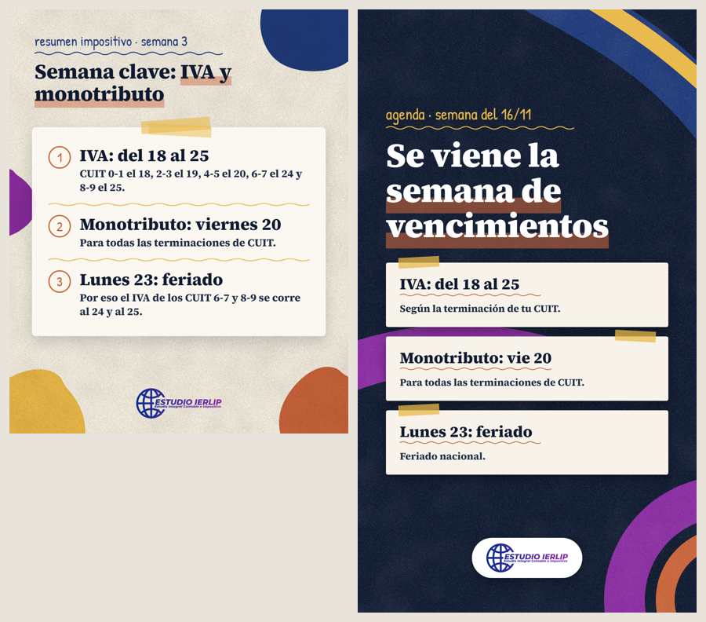

- Placa: 2026-11-15T11:00:00-03:00 · Historia: 2026-11-15T09:00:00-03:00
- Sticker nativo: ninguno

**Caption**

```
📌 Se viene la semana más cargada del mes:

• IVA: del 18 al 25, según CUIT (0-1 el 18, 2-3 el 19, 4-5 el 20, 6-7 el 24 y 8-9 el 25).
• Monotributo: viernes 20, todas las terminaciones.
• Lunes 23: feriado nacional.

Guardalo para cuando lo necesites 📌
Escribinos por WhatsApp: +54 11 4992-2513
@estudioierlip · estudioierlip.com

#EstudioIERLIP #Vencimientos #IVA #Monotributo #ARCA #Impuestos #Pymes
```

**VERIFICAR ANTES DE PUBLICAR**

- [ ] Volver a mirar la agenda de ARCA el 14/11 por si hay prórrogas.

**Fuentes**

- https://seti.afip.gob.ar/av/seleccionVencimientos.do (agenda oficial de noviembre 2026)

## 2026-11-16 (lun) · Tutorial ARCA: Mis Comprobantes: descargá lo que facturaste

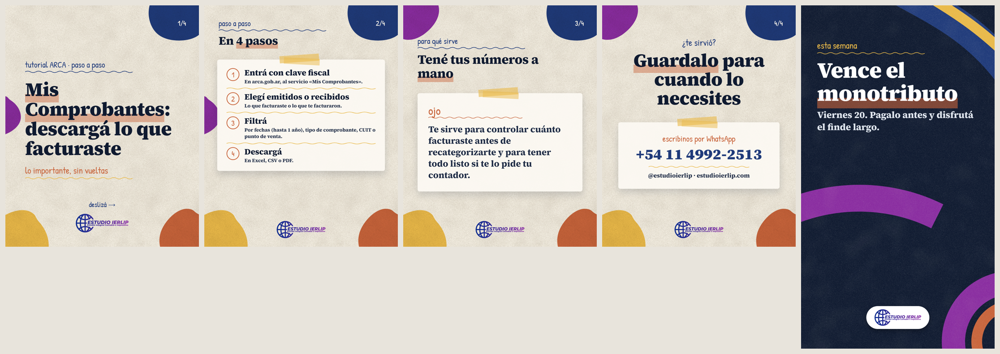

- Placa: 2026-11-16T12:00:00-03:00 · Historia: 2026-11-16T09:00:00-03:00
- Sticker nativo: Link a WhatsApp: https://wa.me/541149922513 (texto: «Escribinos»)

**Caption**

```
🧾 ¿Necesitás ver todo lo que facturaste? Está en «Mis Comprobantes» de ARCA:

1. Entrá con tu clave fiscal.
2. Elegí emitidos o recibidos.
3. Filtrá por fechas (hasta 1 año), tipo de comprobante, CUIT o punto de venta.
4. Descargá en Excel, CSV o PDF.

Guardalo para cuando lo necesites 📌
Escribinos por WhatsApp: +54 11 4992-2513
@estudioierlip · estudioierlip.com

#EstudioIERLIP #ARCA #MisComprobantes #Facturacion #Monotributo #Tutorial #Emprendedores
```

**VERIFICAR ANTES DE PUBLICAR**

- [ ] Entrar a «Mis Comprobantes» y confirmar que filtros y formatos de descarga coincidan con la pieza.

**Fuentes**

- https://servicioscf.afip.gob.ar/publico/sitio/contenido/novedad/ver.aspx?id=2687

## 2026-11-17 (mar) · ARBA: Cómo ver tus percepciones y retenciones en ARBA

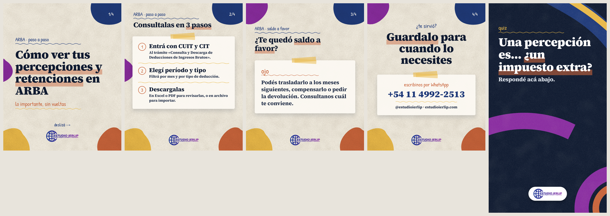

- Placa: 2026-11-17T12:00:00-03:00 · Historia: 2026-11-17T09:00:00-03:00
- Sticker nativo: Cuestionario: Un impuesto extra / Un pago a cuenta (correcta: Un pago a cuenta)

**Caption**

```
🔎 ¿Sabés cuánto te percibieron y retuvieron de Ingresos Brutos? Lo ves en ARBA:

1. Entrá con tu CUIT y tu CIT a «Consulta y Descarga de Deducciones de Ingresos Brutos».
2. Elegí el período y el tipo de deducción.
3. Descargalas en Excel o PDF.

¿Te quedó saldo a favor? Se puede trasladar, compensar o pedir la devolución.

Guardalo para cuando lo necesites 📌
Escribinos por WhatsApp: +54 11 4992-2513
@estudioierlip · estudioierlip.com

#EstudioIERLIP #ARBA #IngresosBrutos #Percepciones #Retenciones #SaldoAFavor #Impuestos
```

**VERIFICAR ANTES DE PUBLICAR**

- Nada pendiente.

**Fuentes**

- https://www.arba.gov.ar/GuiaTramites/TramiteSeleccionado.asp?tramite=604
- https://www.arba.gov.ar/GuiaTramites/TramiteSeleccionado.asp?tramite=650&categ=33
- https://www.arba.gov.ar/Intranet/Legislacion/Normas/Resoluciones/2026/Res016-26.pdf

## 2026-11-18 (mie) · AGIP: ¿Tenés deuda en AGIP? Plan de facilidades


- Placa: 2026-11-18T12:00:00-03:00 · Historia: 2026-11-18T09:00:00-03:00
- Sticker nativo: Encuesta: Lo sabía / No lo sabía

**Caption**

```
🏦 ¿Tenés deuda en AGIP? Hay un plan de facilidades permanente:

• Sirve para todos los impuestos de AGIP.
• Hasta 36 cuotas, para deudas en instancia administrativa o judicial.
• Te adherís desde el Portal del Contribuyente, sección «Planes de Facilidades».

Antes de adherirte, hacé la cuenta: contado o cuotas. Te ayudamos.

Guardalo para cuando lo necesites 📌
Escribinos por WhatsApp: +54 11 4992-2513
@estudioierlip · estudioierlip.com

#EstudioIERLIP #AGIP #CABA #PlanDeFacilidades #Deudas #Impuestos #Pymes
```

**VERIFICAR ANTES DE PUBLICAR**

- [ ] Confirmar en agip.gob.ar que el plan permanente siga en hasta 36 cuotas.
- [ ] Hay un plan especial para ABL y Patentes (Res. 383/AGIP/2026) que no se menciona: solo visto en un resumen.

**Fuentes**

- https://www.agip.gob.ar/impuestos/planes-de-facilidades
- https://lb.agip.gob.ar/PlanFacilidadesBoleta/
- https://seti.afip.gob.ar/av/seleccionVencimientos.do (agenda oficial de noviembre 2026)

## 2026-11-19 (jue) · Vencimientos: Monotributo: 3 formas de pagarlo

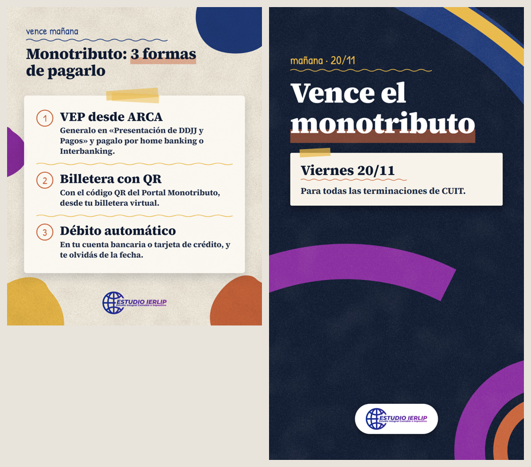

- Placa: 2026-11-19T12:00:00-03:00 · Historia: 2026-11-19T09:00:00-03:00
- Sticker nativo: Cuenta regresiva: «Vence el monotributo», 20/11 a las 23:59

**Caption**

```
⏰ Mañana vence el monotributo. Tres formas de pagarlo:

1. VEP desde ARCA («Presentación de DDJJ y Pagos»), por home banking o Interbanking.
2. Con el QR del Portal Monotributo, desde tu billetera virtual.
3. Débito automático en tu cuenta o tarjeta de crédito.

Guardalo para cuando lo necesites 📌
Escribinos por WhatsApp: +54 11 4992-2513
@estudioierlip · estudioierlip.com

#EstudioIERLIP #Monotributo #ARCA #Vencimientos #VEP #Emprendedores #Impuestos
```

**VERIFICAR ANTES DE PUBLICAR**

- Nada pendiente.

**Fuentes**

- https://www.arca.gob.ar/comoPagarImpuestos/como-pagar-impuestos/monotributo/desde-07-2004.asp
- https://seti.afip.gob.ar/av/seleccionVencimientos.do (agenda oficial de noviembre 2026)

## 2026-11-20 (vie) · Mito o verdad: El monotributo incluye la obra social

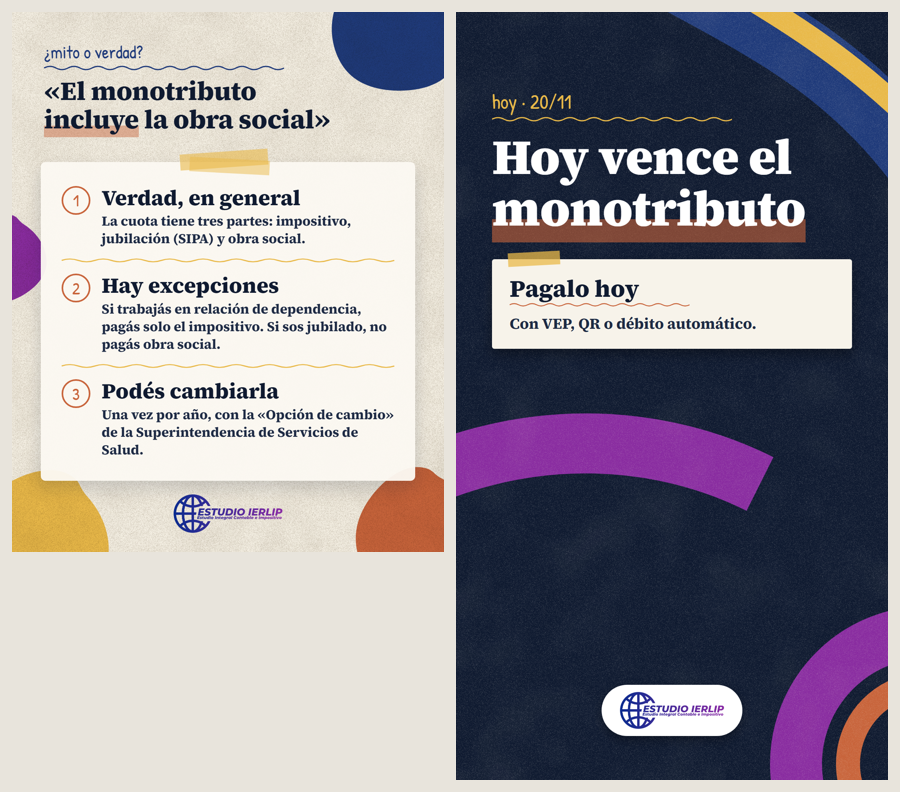

- Placa: 2026-11-20T12:00:00-03:00 · Historia: 2026-11-20T09:00:00-03:00
- Sticker nativo: Link a WhatsApp: https://wa.me/541149922513 (texto: «Escribinos»)

**Caption**

```
🤔 ¿Mito o verdad? «El monotributo incluye la obra social».

Verdad, en general: la cuota tiene tres partes, impositivo, jubilación (SIPA) y obra social.

Pero hay excepciones: si trabajás en relación de dependencia pagás solo el impositivo, y si sos jubilado no pagás obra social.

¿Querés cambiar de obra social? Se puede una vez por año, con la «Opción de cambio» de la SSSalud.

Guardalo para cuando lo necesites 📌
Escribinos por WhatsApp: +54 11 4992-2513
@estudioierlip · estudioierlip.com

#EstudioIERLIP #Monotributo #ObraSocial #MitoOVerdad #ARCA #Emprendedores #Impuestos
```

**VERIFICAR ANTES DE PUBLICAR**

- [ ] Desde cuándo rige el cambio de obra social: SSSalud y argentina.gob.ar se contradicen (no se menciona en la pieza).

**Fuentes**

- https://www.afip.gob.ar/monotributo/ayuda/tipos-de-monotributo.asp
- https://www.argentina.gob.ar/sssalud/usuarios/cambio-obra-sociales/monotributistas
- https://www.argentina.gob.ar/servicio/realizar-opcion-de-cambio-libre-eleccion-de-agentes-del-seguro
